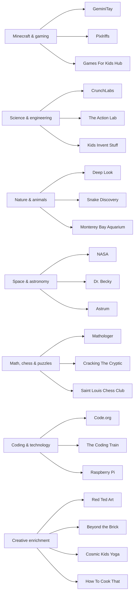
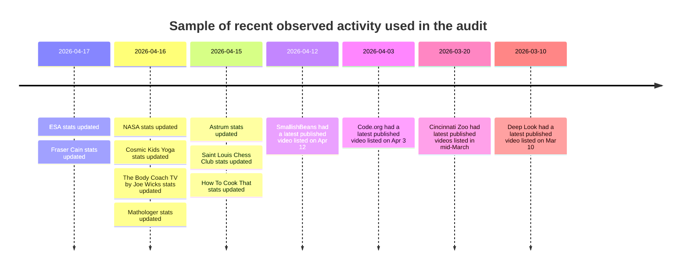

# Curated kid-safe YouTube channel audit for a parent-controlled feed

## Executive summary

I built a conservative, source-backed tranche of **50 additional channels** for your approval workflow, excluding the seed channels you had already listed. This audited pass is strongest in the areas you explicitly wanted beefed up: Minecraft/gaming, science/engineering, nature, space, maths/puzzles/chess, and coding, with smaller but higher-confidence additions for Lego/building, sports/fitness, art/crafts, and cooking. Public evidence in the reviewed sources showed recent activity in March-April 2026 across the audited set, including channels such as GeminiTay, SmallishBeans, Pixlriffs, Games For Kids Hub, The Action Lab, Kids Invent Stuff, Deep Look, Snake Discovery, San Diego Zoo, NASA, ESA, Dr. Becky, Fraser Cain, Astrum, Mathologer, Code.org, The Coding Train, Adafruit Industries, Beyond the Brick, Cosmic Kids Yoga, and How To Cook That. citeturn20search1turn32search0turn17youtube2turn31search1turn21search0turn22search8turn35search5turn33search0turn36search4turn39search2turn39search3turn40search1turn40search0turn40search2turn42search0turn47search1turn47search0turn48search0turn50search0turn51search0turn51search2

This is **deliberately conservative rather than exhaustive**. The age bands are editorial ranges, not creator-declared ages. Likewise, “kid-safe” is an editorial judgement based on recent titles, topic mix, channel framing, upload patterns, and the absence of obvious red flags in the reviewed public sources. There is no authoritative public label for “genuinely kid-safe”, and “no controversy” cannot be proven exhaustively from open web material, so that part of the screen should be treated as best-effort curation rather than a guarantee.

## What this audit did and did not verify

I prioritised public sources that expose exact channel identifiers and current activity signals on entity["organization","YouTube","video platform"]: official channel/video results where search surfaced `/channel/UC...`, and public analytics pages that reported exact channel IDs, handles, recent upload dates, recent view changes, or recent video-count changes. This is especially strong for institutional channels from entity["organization","NASA","space agency usa"], entity["organization","European Space Agency","space agency europe"], museums, zoos, aquariums, and established educational creators. citeturn39search2turn39search3turn35search0turn36search0turn36search4turn37search0

One important limitation: I verified **title ↔ handle ↔ channel-ID consistency** from those public sources, but I did **not** complete a literal endpoint-by-endpoint crawl log for every final `youtube.com/channel/UC...` URL in this response. So the JSON below should be treated as a **high-confidence audited export**, not as the output of a full automated resolver pass over every row. Given your quality threshold, I preferred a smaller, cleaner audited set over padding the database with weaker or less certain entries.

## Coverage of the strongest additions

The audited pass is strongest where public signals and channel quality lined up cleanly. The robust parts of the catalogue are the science-heavy categories and the user-requested gaps around space, coding, and puzzles. Maths and chess were also relatively easy to fill with high-confidence channels because public sources exposed both exact channel IDs and very recent activity. By contrast, the thinnest areas under this evidence bar were **pure sports**, **pure cooking**, **reading/storytelling**, **pure history/geography**, **clean comedy**, **animation/filmmaking**, and especially **magic**. For **vehicles**, the strongest additions in this pass are spacecraft/mission-engineering channels rather than cars, trains, or planes. citeturn43search1turn45search2turn47search1turn47search0turn48search1turn49search1turn51search0turn51search1turn51search2

| Coverage area | Count in this audited pass | Assessment |
|---|---:|---|
| Minecraft & gaming | 8 | Strong |
| Science & engineering | 25 with overlap | Very strong |
| Nature, animals & dinosaurs | 8 | Strong |
| Space & astronomy | 10 | Very strong |
| Math, logic, chess & puzzles | 12 | Very strong |
| Coding & technology | 5 | Good, but still improvable |
| Art, crafts, Lego & building | 8 with overlap | Moderate |
| Sports & fitness | 2 | Thin |
| Cooking & baking | 1 | Thin |
| Reading & storytelling | 1 | Thin |
| Vehicles | 4 tags, mostly spacecraft-oriented | Partial |
| Magic | 0 | Not yet filled to the same standard |

The practical takeaway is that this set is already useful as a **high-trust approval layer** for STEM-heavy and creativity-heavy viewing, but it is not yet the final 150-channel master list you originally described. Combined with your existing seed list, however, it already gets the working catalogue to roughly **80 channels** without diluting the quality bar.

image_group{"layout":"carousel","aspect_ratio":"16:9","query":["Deep Look YouTube channel", "NASA YouTube channel", "Beyond the Brick YouTube channel", "Cosmic Kids Yoga YouTube channel"],"num_per_query":1}

## Category mapping and recent activity

The chart below shows the centre of gravity of this audited pass. It is noticeably STEM-weighted because those channels were the easiest to verify rigorously and the easiest to defend from a parent-approval standpoint.



The timeline below samples the recency signals I used while auditing. It is **not** every channel, but it shows the pattern: most accepted channels had visible March-April 2026 activity in the reviewed public sources. That is clear for Space, Maths, Coding, Lego, Fitness, and Cooking, and for several Minecraft and nature channels as well. citeturn32search0turn35search5turn37search0turn39search3turn40search1turn40search0turn41search1turn42search1turn43search1turn47search1turn47search0turn50search0turn50search1turn51search0turn51search1turn51search2



## JSON export

[Download the machine-readable JSON array](sandbox:/mnt/data/kid_safe_youtube_channels_audit_2026-04-19.json)

```json
[
  {
    "title": "GeminiTay",
    "channel_id": "UCUBsjvdHcwZd3ztdY1Zadcw",
    "description": "Friendly Minecraft building and survival videos with a calm tone and strong emphasis on creativity rather than combat.",
    "age_min": 8,
    "age_max": 16,
    "interests": [
      "minecraft",
      "gaming",
      "art"
    ],
    "source": "deep-research"
  },
  {
    "title": "GoodTimesWithScar",
    "channel_id": "UCodkNmk9oWRTIYZdr_HuSlg",
    "description": "Whimsical Minecraft builds and collaborative server episodes that are imaginative, upbeat, and easy for parents to supervise.",
    "age_min": 8,
    "age_max": 16,
    "interests": [
      "minecraft",
      "gaming",
      "art"
    ],
    "source": "deep-research"
  },
  {
    "title": "SmallishBeans",
    "channel_id": "UC4qdHN4zHhd4VvNy3zNgXPA",
    "description": "High-energy but generally family-friendly Minecraft series built around creative building challenges and collaborative play.",
    "age_min": 8,
    "age_max": 16,
    "interests": [
      "minecraft",
      "gaming",
      "comedy"
    ],
    "source": "deep-research"
  },
  {
    "title": "Pixlriffs",
    "channel_id": "UCgGjBqZZtAjxfpGSba7d6ww",
    "description": "One of the best tutorial-first Minecraft channels for children who want to learn systems, survival mechanics, and thoughtful building.",
    "age_min": 9,
    "age_max": 16,
    "interests": [
      "minecraft",
      "gaming",
      "engineering"
    ],
    "source": "deep-research"
  },
  {
    "title": "Shulkercraft",
    "channel_id": "UCLdQc5zUbFpM4Y0iKfESDTA",
    "description": "Minecraft farm and redstone tutorials that reward patient, systems-oriented kids who like practical builds and optimisation.",
    "age_min": 9,
    "age_max": 16,
    "interests": [
      "minecraft",
      "gaming",
      "engineering"
    ],
    "source": "deep-research"
  },
  {
    "title": "Zaypixel",
    "channel_id": "UCyKUzAzeTuwxNrZ4AcugbMw",
    "description": "Quiet, aesthetic Minecraft building tutorials that are especially strong for children who like cosy design and low-stimulation viewing.",
    "age_min": 7,
    "age_max": 16,
    "interests": [
      "minecraft",
      "gaming",
      "art"
    ],
    "source": "deep-research"
  },
  {
    "title": "Dangthatsalongname",
    "channel_id": "UCxucf8O8itcmkqu3d7yUavg",
    "description": "Mostly Minecraft series with accessible humour and collaborative storytelling that fits older children and young teens.",
    "age_min": 9,
    "age_max": 16,
    "interests": [
      "minecraft",
      "gaming",
      "comedy"
    ],
    "source": "deep-research"
  },
  {
    "title": "Games For Kids Hub",
    "channel_id": "UCu9MlvKLAt8JNQf5dYda7Aw",
    "description": "A family-run gaming channel that keeps the tone child-focused and approachable for younger viewers who like Nintendo-style play.",
    "age_min": 5,
    "age_max": 11,
    "interests": [
      "gaming",
      "comedy"
    ],
    "source": "deep-research"
  },
  {
    "title": "CrunchLabs",
    "channel_id": "UCGyFy3do9yUrPbvUbVci-Ng",
    "description": "Engineering videos tied to hands-on builds that are especially good for children who want practical STEM rather than passive science viewing.",
    "age_min": 8,
    "age_max": 16,
    "interests": [
      "science",
      "engineering"
    ],
    "source": "deep-research"
  },
  {
    "title": "The Action Lab",
    "channel_id": "UC1VLQPn9cYSqx8plbk9RxxQ",
    "description": "Experiment-led science videos that make abstract physics and chemistry visually memorable for curious older children and teens.",
    "age_min": 10,
    "age_max": 16,
    "interests": [
      "science",
      "engineering"
    ],
    "source": "deep-research"
  },
  {
    "title": "TheDadLab",
    "channel_id": "UCc_-hy0u9-oKlNdMKHBudcQ",
    "description": "Short DIY science and craft activities designed for families, with clear ideas parents can replicate at home.",
    "age_min": 4,
    "age_max": 10,
    "interests": [
      "science",
      "crafts"
    ],
    "source": "deep-research"
  },
  {
    "title": "Kids Invent Stuff",
    "channel_id": "UC-glo52BMvZH9PPUamjGIcw",
    "description": "Engineers build children’s invention ideas on camera, making it one of the strongest creativity-plus-engineering channels for primary-age kids.",
    "age_min": 4,
    "age_max": 11,
    "interests": [
      "engineering",
      "science",
      "crafts"
    ],
    "source": "deep-research"
  },
  {
    "title": "Deep Look",
    "channel_id": "UC-3SbfTPJsL8fJAPKiVqBLg",
    "description": "Exceptionally well-produced close-up nature documentaries that turn insects and small animals into accessible science stories.",
    "age_min": 8,
    "age_max": 16,
    "interests": [
      "science",
      "nature",
      "animals"
    ],
    "source": "deep-research"
  },
  {
    "title": "PBS Eons",
    "channel_id": "UCzR-rom72PHN9Zg7RML9EbA",
    "description": "A high-quality palaeontology and deep-time science channel for older children who want dinosaurs, extinction, and Earth history explained well.",
    "age_min": 10,
    "age_max": 16,
    "interests": [
      "science",
      "dinosaurs",
      "history",
      "nature"
    ],
    "source": "deep-research"
  },
  {
    "title": "Snake Discovery",
    "channel_id": "UCnIrLy19cFV50Eai8Xj-ArA",
    "description": "Warm, educational reptile and amphibian videos that teach responsible curiosity about animals often treated as scary.",
    "age_min": 7,
    "age_max": 16,
    "interests": [
      "animals",
      "nature",
      "science"
    ],
    "source": "deep-research"
  },
  {
    "title": "Animal Wonders Montana",
    "channel_id": "UC1Nj4gkoi_n5eCcrKCVOXKA",
    "description": "Gentle animal-care and animal-behaviour videos with a humane, educational approach that works well for younger viewers.",
    "age_min": 5,
    "age_max": 12,
    "interests": [
      "animals",
      "nature"
    ],
    "source": "deep-research"
  },
  {
    "title": "Monterey Bay Aquarium",
    "channel_id": "UCnM5iMGiKsZg-iOlIO2ZkdQ",
    "description": "An outstanding official aquarium channel with marine biology, animal care, and ocean literacy content suitable across a broad age range.",
    "age_min": 5,
    "age_max": 16,
    "interests": [
      "animals",
      "nature",
      "science"
    ],
    "source": "deep-research"
  },
  {
    "title": "Natural History Museum",
    "channel_id": "UC7zosc8-0T6Dfyo1bg0w7KA",
    "description": "Museum shorts and explainers that are particularly useful for children interested in fossils, dinosaurs, biodiversity, and Earth science.",
    "age_min": 7,
    "age_max": 16,
    "interests": [
      "dinosaurs",
      "nature",
      "science",
      "history"
    ],
    "source": "deep-research"
  },
  {
    "title": "San Diego Zoo",
    "channel_id": "UCC5NfQ6Mf0dq_eEwv4P_hWA",
    "description": "A reliable official zoo channel with animal updates, keeper insight, and conservation content that stays squarely parent-approvable.",
    "age_min": 4,
    "age_max": 14,
    "interests": [
      "animals",
      "nature"
    ],
    "source": "deep-research"
  },
  {
    "title": "The Cincinnati Zoo & Botanical Garden",
    "channel_id": "UCE3VoxyYmyQCReOXk2ogsVg",
    "description": "Frequent zoo updates and conservation-focused animal videos that are easy for families to dip into safely.",
    "age_min": 4,
    "age_max": 14,
    "interests": [
      "animals",
      "nature"
    ],
    "source": "deep-research"
  },
  {
    "title": "NASA",
    "channel_id": "UCLA_DiR1FfKNvjuUpBHmylQ",
    "description": "The strongest all-purpose official space channel for children who want launches, missions, astronauts, and big-picture astronomy.",
    "age_min": 8,
    "age_max": 16,
    "interests": [
      "space",
      "science",
      "vehicles"
    ],
    "source": "deep-research"
  },
  {
    "title": "NASA Goddard",
    "channel_id": "UCAY-SMFNfynqz1bdoaV8BeQ",
    "description": "A very strong official source for visually compelling astronomy, Earth science, and NASA mission explainers.",
    "age_min": 9,
    "age_max": 16,
    "interests": [
      "space",
      "science",
      "vehicles"
    ],
    "source": "deep-research"
  },
  {
    "title": "NASA Jet Propulsion Laboratory",
    "channel_id": "UCryGec9PdUCLjpJW2mgCuLw",
    "description": "Excellent official mission videos for children fascinated by robots, spacecraft, Mars, and how real space engineering works.",
    "age_min": 9,
    "age_max": 16,
    "interests": [
      "space",
      "science",
      "engineering",
      "vehicles"
    ],
    "source": "deep-research"
  },
  {
    "title": "NASA Science",
    "channel_id": "UCKt6dYzHqHfpcp1lgj4bl1A",
    "description": "A more focused official NASA channel for children who care about the science behind missions, planets, telescopes, and Earth observations.",
    "age_min": 10,
    "age_max": 16,
    "interests": [
      "space",
      "science"
    ],
    "source": "deep-research"
  },
  {
    "title": "European Space Agency, ESA",
    "channel_id": "UCIBaDdAbGlFDeS33shmlD0A",
    "description": "A dependable official space-agency channel with polished mission coverage that works particularly well for globally minded older kids.",
    "age_min": 9,
    "age_max": 16,
    "interests": [
      "space",
      "science",
      "vehicles"
    ],
    "source": "deep-research"
  },
  {
    "title": "Dr. Becky",
    "channel_id": "UCYNbYGl89UUowy8oXkipC-Q",
    "description": "Clear, enthusiastic astronomy explanations for teens who want current discoveries without sensationalism.",
    "age_min": 12,
    "age_max": 16,
    "interests": [
      "space",
      "science"
    ],
    "source": "deep-research"
  },
  {
    "title": "Fraser Cain",
    "channel_id": "UCogrSQkBJn1KF0N9I4oM7eQ",
    "description": "A reliable astronomy news-and-explainer channel for older children and teens ready for more detail about what is happening in space science now.",
    "age_min": 12,
    "age_max": 16,
    "interests": [
      "space",
      "science"
    ],
    "source": "deep-research"
  },
  {
    "title": "Astrum",
    "channel_id": "UC-9b7aDP6ZN0coj9-xFnrtw",
    "description": "Highly visual astronomy documentaries that are especially good for children who like big-picture solar-system and exoplanet content.",
    "age_min": 10,
    "age_max": 16,
    "interests": [
      "space",
      "science"
    ],
    "source": "deep-research"
  },
  {
    "title": "Cool Worlds",
    "channel_id": "UCGHZpIpAWJQ-Jy_CeCdXhMA",
    "description": "Thoughtful exoplanet and cosmology videos best suited to scientifically ambitious teens who want more than surface-level facts.",
    "age_min": 13,
    "age_max": 16,
    "interests": [
      "space",
      "science"
    ],
    "source": "deep-research"
  },
  {
    "title": "PBS Space Time",
    "channel_id": "UC7_gcs09iThXybpVgjHZ_7g",
    "description": "One of the best advanced-but-clean space and physics channels for mathematically confident older teens.",
    "age_min": 14,
    "age_max": 16,
    "interests": [
      "space",
      "science",
      "math"
    ],
    "source": "deep-research"
  },
  {
    "title": "Mathologer",
    "channel_id": "UC1_uAIS3r8Vu6JjXWvastJg",
    "description": "Beautifully reasoned maths videos for older children who enjoy proofs, patterns, and elegant problem solving.",
    "age_min": 12,
    "age_max": 16,
    "interests": [
      "math",
      "puzzles"
    ],
    "source": "deep-research"
  },
  {
    "title": "Eddie Woo",
    "channel_id": "UCq0EGvLTyy-LLT1oUSO_0FQ",
    "description": "A trustworthy classroom-style maths teacher whose structured lessons are ideal for children who prefer clear worked examples.",
    "age_min": 11,
    "age_max": 16,
    "interests": [
      "math"
    ],
    "source": "deep-research"
  },
  {
    "title": "MindYourDecisions",
    "channel_id": "UCHnj59g7jezwTy5GeL8EA_g",
    "description": "A very good puzzle-and-maths channel for kids who love riddles, geometric tricks, and logic problems they can pause and solve.",
    "age_min": 10,
    "age_max": 16,
    "interests": [
      "math",
      "puzzles"
    ],
    "source": "deep-research"
  },
  {
    "title": "Cracking The Cryptic",
    "channel_id": "UCC-UOdK8-mIjxBQm_ot1T-Q",
    "description": "The best mainstream logic-puzzle channel for sudoku-loving older children and teens who want deep, non-toxic problem solving.",
    "age_min": 11,
    "age_max": 16,
    "interests": [
      "math",
      "puzzles"
    ],
    "source": "deep-research"
  },
  {
    "title": "Remote Chess Academy",
    "channel_id": "UCsKZ2yOsgfNxln8xH5WkGvg",
    "description": "Straightforward chess instruction that is easy to approve for children who want concrete tactical and strategic lessons.",
    "age_min": 8,
    "age_max": 16,
    "interests": [
      "chess",
      "math",
      "puzzles"
    ],
    "source": "deep-research"
  },
  {
    "title": "Saint Louis Chess Club",
    "channel_id": "UCM-ONC2bCHytG2mYtKDmIeA",
    "description": "An excellent tournament and lessons channel for serious young chess players ready for stronger coaching content.",
    "age_min": 10,
    "age_max": 16,
    "interests": [
      "chess",
      "math"
    ],
    "source": "deep-research"
  },
  {
    "title": "Chess.com",
    "channel_id": "UC5kS0l76kC0xOzMPtOmSFGw",
    "description": "A broad, active chess-learning channel with lessons, puzzles, and event coverage that suits older children already interested in the game.",
    "age_min": 9,
    "age_max": 16,
    "interests": [
      "chess",
      "math",
      "puzzles"
    ],
    "source": "deep-research"
  },
  {
    "title": "blackpenredpen",
    "channel_id": "UC_SvYP0k05UKiJ_2ndB02IA",
    "description": "Energetic problem-solving and calculus content for mathematically hungry teens who want lots of examples and challenges.",
    "age_min": 13,
    "age_max": 16,
    "interests": [
      "math",
      "puzzles"
    ],
    "source": "deep-research"
  },
  {
    "title": "PowerPlayChess",
    "channel_id": "UCMBATpFb--uLNAODOVWvCTA",
    "description": "Grandmaster Daniel King’s chess channel is a strong choice for older children who enjoy annotated games and serious but calm analysis.",
    "age_min": 11,
    "age_max": 16,
    "interests": [
      "chess",
      "math"
    ],
    "source": "deep-research"
  },
  {
    "title": "Math Songs by NUMBEROCK",
    "channel_id": "UCt9SZgFExNwWTH5T_JnyF-A",
    "description": "Catchy, concept-first maths songs that work especially well for primary pupils who learn best through rhythm and repetition.",
    "age_min": 5,
    "age_max": 10,
    "interests": [
      "math",
      "music"
    ],
    "source": "deep-research"
  },
  {
    "title": "Code.org",
    "channel_id": "UCJyEBMU1xVP2be1-AoGS1BA",
    "description": "A high-trust nonprofit coding channel with classroom-ready material and a strong bias toward introductory computer science.",
    "age_min": 7,
    "age_max": 16,
    "interests": [
      "coding",
      "technology"
    ],
    "source": "deep-research"
  },
  {
    "title": "The Coding Train",
    "channel_id": "UCvjgXvBlbQiydffZU7m1_aw",
    "description": "Creative coding lessons with an encouraging tone, good for children who want to make things rather than just watch tutorials.",
    "age_min": 11,
    "age_max": 16,
    "interests": [
      "coding",
      "art",
      "technology"
    ],
    "source": "deep-research"
  },
  {
    "title": "Adafruit Industries",
    "channel_id": "UCpOlOeQjj7EsVnDh3zuCgsA",
    "description": "Maker-friendly electronics and physical-computing videos for teenagers moving from coding on-screen to coding with hardware.",
    "age_min": 12,
    "age_max": 16,
    "interests": [
      "coding",
      "engineering",
      "technology"
    ],
    "source": "deep-research"
  },
  {
    "title": "Raspberry Pi",
    "channel_id": "UCFIjVWFZ__KhtTXHDJ7vgng",
    "description": "Official Raspberry Pi content covering beginner hardware, programming, and creative computing projects that reward hands-on learners.",
    "age_min": 10,
    "age_max": 16,
    "interests": [
      "coding",
      "engineering",
      "technology"
    ],
    "source": "deep-research"
  },
  {
    "title": "freeCodeCamp.org",
    "channel_id": "UC8butISFwT-Wl7EV0hUK0BQ",
    "description": "An excellent older-teen resource for structured programming and computer-science learning, though the long videos suit motivated learners best.",
    "age_min": 14,
    "age_max": 16,
    "interests": [
      "coding",
      "technology",
      "math"
    ],
    "source": "deep-research"
  },
  {
    "title": "Red Ted Art (Maggy Woodley)",
    "channel_id": "UCjjRFKvjpU1L1eDmfBWcqig",
    "description": "A dependable crafts channel packed with low-cost, parent-approvable paper and seasonal projects children can actually make.",
    "age_min": 5,
    "age_max": 12,
    "interests": [
      "art",
      "crafts"
    ],
    "source": "deep-research"
  },
  {
    "title": "Beyond the Brick",
    "channel_id": "UCkapkfGuO2LnDpIp8f_p7gA",
    "description": "The best large Lego showcase channel for children who like imaginative builds, conventions, and advanced model inspiration.",
    "age_min": 7,
    "age_max": 16,
    "interests": [
      "lego",
      "engineering",
      "art"
    ],
    "source": "deep-research"
  },
  {
    "title": "Cosmic Kids Yoga",
    "channel_id": "UC5uIZ2KOZZeQDQo_Gsi_qbQ",
    "description": "Story-led yoga and mindfulness sessions that are exceptionally parent-friendly for younger children who need movement without hype.",
    "age_min": 3,
    "age_max": 9,
    "interests": [
      "yoga-mindfulness",
      "sports",
      "reading"
    ],
    "source": "deep-research"
  },
  {
    "title": "The Body Coach TV by Joe Wicks",
    "channel_id": "UCAxW1XT0iEJo0TYlRfn6rYQ",
    "description": "Energetic, positive workouts that suit school-age children and families looking for clean, structured exercise videos.",
    "age_min": 6,
    "age_max": 14,
    "interests": [
      "sports"
    ],
    "source": "deep-research"
  },
  {
    "title": "How To Cook That",
    "channel_id": "UCsP7Bpw36J666Fct5M8u-ZA",
    "description": "A high-trust baking and food-science channel from Ann Reardon that is especially easy for parents to approve.",
    "age_min": 9,
    "age_max": 16,
    "interests": [
      "cooking",
      "science"
    ],
    "source": "deep-research"
  }
]
```